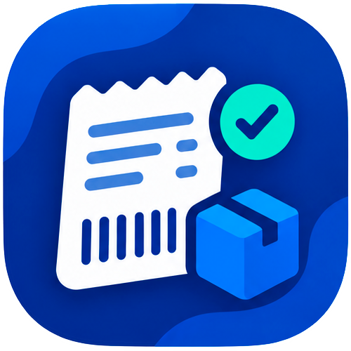

<div align="center">



# keepinventory

**Gestor de ventas e inventario personalizable, hecho con Flutter e IA.**

Inventario + punto de venta (TPV) para Android, pensado para ferias, mercadillos y pequeños negocios.
Funciona 100 % sin conexión: tus datos viven en tu móvil.

[](https://github.com/nesherben/KeepInventory/releases/latest)
[](https://github.com/nesherben/KeepInventory/actions/workflows/build.yml)


[](LICENSE)
[](https://www.paypal.me/nestor8299)

</div>

---

## 📑 Índice

- [Funcionalidades](#-funcionalidades)
- [Instalación](#-instalación)
- [Guía de uso](#-guía-de-uso)
- [Sincronizar entre móviles](#-sincronizar-entre-móviles)
- [Copias de seguridad](#-copias-de-seguridad)
- [Desarrollo](#-desarrollo)
- [Idiomas](#-idiomas)
- [Donaciones](#-donaciones)

---

## ✨ Funcionalidades

| | |
|---|---|
| 📦 **Inventario** | Productos con foto, unidades, precio de venta y coste. Margen calculado (también en vivo al crear el producto), alertas de stock bajo / agotado, filtros y ordenación (nombre, unidades, precio, coste, margen). Vista en tarjetas en el móvil (con botón **Ordenar**) y tabla en pantallas grandes con la cabecera siempre visible al hacer scroll. Junto a las unidades, el icono 🎁 con un número indica cuántas unidades del producto están dentro de packs montados (no cuentan como stock disponible). Edición rápida de stock con − / + y de cada campo tocándolo. |
| 🗂️ **Categorías** | Opcionales (p. ej. *Camisetas*, *Tazas*): se eligen o se crean desde el producto, sirven para filtrar en Inventario y Ventas, para aplicar una promoción a todos sus productos de golpe y para combos del tipo *"cualquier camiseta + cualquier taza"*. Los productos que ya son un grupo en sí (p. ej. *Llaveros variados*, todos al mismo precio) no necesitan categoría. |
| 🎁 **Packs** | Agrupa varios productos en un pack con su propio precio y stock de unidades montadas. Muestra cuánto ahorra el cliente frente a comprarlos por separado y cuántos más se pueden montar con el stock actual. |
| 🏷️ **Promociones** | Descuento por porcentaje (p. ej. 10 % a partir de 2 uds.) o precio fijo por lote (p. ej. *3 por 12 €*), con soporte Mix & Match entre productos de la misma promoción. Al crearla, una frase explica la regla y se sugiere el nombre. |
| 🧩 **Combos** | Precio fijo por un conjunto de productos distintos (p. ej. *camiseta + gorra = 20 €*) o de categorías (*cualquier camiseta + cualquier taza = 20 €*). Se detectan solos en el carrito, sin stock propio: cada producto descuenta el suyo. |
| 🧾 **Caja (TPV)** | Catálogo con buscador, carrito con promociones y combos aplicados automáticamente, ajuste manual del total para acordar un precio global y cobro indicando el método de pago (efectivo, PayPal, Bizum). |
| 🕘 **Tickets y ferias** | Historial de ventas agrupado por día o por feria, ticket de cada venta y devoluciones parciales o totales (los packs pueden devolverse enteros o por componentes) calculadas correctamente aunque hubiera promociones o combos. |
| 🏠 **Inicio** | Ingresos, beneficio y desglose por método de pago, con gráfica de ventas a pantalla completa. |
| 🔄 **Sincronización** | Pasa toda la base de datos a otro móvil con un QR. **No hace falta Wi‑Fi compartida**: la app crea su propio punto de acceso. |
| 💾 **Backups** | Copia automática diaria (a las 00:00) en el móvil que se restaura sola en una instalación nueva, copia manual en Google Drive y exportación / importación de la base de datos. |
| 🎨 **Personalización** | Tema claro / oscuro, colores dinámicos (Material You), español e inglés (idioma del móvil; inglés si no está traducido). |
| ⬆️ **Actualizaciones** | La app avisa cuando hay una nueva versión publicada en GitHub Releases. |

---

## 📲 Instalación

1. Ve a [**Releases**](https://github.com/nesherben/KeepInventory/releases/latest) y descarga el `.apk` más reciente.
2. Ábrelo en tu móvil Android. Si te lo pide, permite *instalar apps de origen desconocido* para tu navegador / gestor de archivos.
3. ¡Listo! Las siguientes versiones te las ofrecerá la propia app desde el aviso de actualización.

> Los APK de Releases están firmados siempre con la misma clave, así que puedes actualizar encima sin perder datos.
> Los APK que genera CI en cada push son solo para pruebas.

---

## 🧭 Guía de uso

El menú lateral (desliza desde el borde izquierdo o pulsa ☰) da acceso a todas las secciones: **Inicio**; **Venta** (Caja y Tickets y ferias); **Catálogo** (Inventario, Ofertas y Packs); **Datos** (Copias y sincronización) y **Ayuda** (Tutorial).

> 📱 Los formularios se adaptan a la pantalla: en el móvil se abren a pantalla completa desde abajo (desliza la pestaña para cerrar), en una tablet en horizontal como panel lateral sin perder de vista la lista, y en vertical como ventana con letra grande.
>
> 🎓 La primera vez que abres la app aparece un **tutorial** rápido y, si aún no tienes productos, el menú se abre solo con **Inventario** resaltado para que sepas por dónde empezar. Puedes volver a verlo cuando quieras desde **menú → Tutorial**.

### 1. Da de alta tu inventario
1. Abre **Inventario** y pulsa **＋**.
2. Rellena nombre, precio de venta, coste y unidades (el botón *Siguiente* del teclado salta de campo). Bajo el coste verás el **margen por unidad** en vivo, en rojo si vendes a pérdidas. Añade una foto si quieres; se comprime automáticamente.
   Si quieres, asígnale una **categoría** (opcional): elige una de la lista o escribe una nueva. Puedes cambiarla luego tocando su etiqueta en el inventario.
3. Usa los filtros para ver rápidamente qué está **bajo de stock**, **agotado**, **con promoción** o de una **categoría**, y ordena: en la tabla tocando la cabecera (la cabecera *Foto* vuelve al orden por defecto) y en el móvil con el botón **Ordenar**.
4. Para retocar algo rápido, toca − / + en el stock o toca directamente el nombre, precio o coste.

### 2. Crea packs (opcional)
1. En **Packs**, pulsa **＋**, ponle nombre, precio y foto.
2. Pulsa **Añadir producto** (con buscador) para elegir los productos que lo forman y cuántas unidades de cada uno lleva. Verás cuánto ahorra el cliente frente a comprarlos sueltos.
3. Indica cuántos packs tienes montados: al crearlos (o cambiar su cantidad) sus componentes salen del inventario, porque ya están en la bolsa; al venderlos solo baja el número de packs. Con − / + en la lista montas o desmontas packs; al desplegar uno verás el stock de cada componente y cuántos más puedes montar.

### 3. Configura promociones y combos (opcional)
1. En **Ofertas → Promociones**, crea una promoción eligiendo el tipo:
   - **Lote a precio fijo** → N unidades por X € (p. ej. *3 por 12 €*).
   - **% de descuento** → X % a partir de N unidades.

   Una frase te explica la regla y el nombre se rellena solo (puedes cambiarlo). Al crearla, la app te pregunta a qué productos aplicarla (una categoría, elegir productos o más tarde). Toca una tarjeta para editarla; en su menú ⋮ tienes **Elegir productos…** y **Aplicar a una categoría…**, que pone la promoción a todos los productos de esa categoría de golpe (luego puedes cambiar cualquiera por separado). Cada promoción muestra a cuántos productos se aplica.
2. Asigna la promoción a los productos desde su ficha de inventario. Los productos que comparten promoción se combinan entre sí (Mix & Match).
3. En **Ofertas → Combos** crea un combo cuando quieras vender **productos distintos juntos** a un precio fijo (p. ej. *1 camiseta + 1 gorra = 20 €*):
   - Elige cada producto (o *cualquier producto de una categoría*) y su cantidad, y el precio del combo; verás el ahorro frente a comprarlos por separado.
   - Solo se aplica si el carrito tiene **todos** los productos del combo (2 camisetas no cuentan), se repite por cada combo completo y lo que sobra va a precio normal.
   - Si un producto tiene además su propia promoción, dentro del combo gana el combo y las unidades sueltas mantienen su promoción.
   - En el inventario verás qué productos forman parte de un combo.

### 4. Vende
1. Abre **Caja (TPV)**, busca o toca los productos / packs para añadirlos al carrito (si usas categorías, los chips bajo el buscador filtran el catálogo). Los productos que forman parte de un combo llevan la insignia **Combo**.
2. Ajusta cantidades: el total ya incluye promociones y combos. Para acordar otro importe, abre el menú junto al total y elige **Ajustar total**; el total anterior queda tachado y el ajuste se reparte proporcionalmente por toda la venta. Si cambias el carrito, se conserva esa proporción. Si un producto tiene descuento, verás el precio original tachado junto al aplicado en el carrito y el ticket. Los combos aparecen agrupados en el carrito, con sus productos dentro. Si tienes medio combo, el carrito te avisa (*"falta Gorra"*): toca el aviso para ir al producto en el catálogo, o pulsa **＋ Añadir** para meterlo en el carrito de un toque.
3. Pulsa **COBRAR**, elige el método de pago y confirma. El stock se descuenta solo y un aviso confirma la venta (*"Venta #12 registrada · 22,00 € · Efectivo"*).
4. Si vendes las últimas unidades de un producto, la app te avisa (*"Última unidad de…"*, *"Quedan 2 en stock"*).

### 5. Consulta el historial y haz devoluciones
1. En **Tickets y ferias** verás las ventas agrupadas por día con su ticket. Para agrupar un día bajo una **feria**, pulsa el botón de feria: busca una de tu lista o escribe una nueva y toca *Crear*. En un grupo de feria, cambiarla o quitarla afecta a **todos** sus tickets (de todos los días); al quitarla, cada ticket vuelve a su día. Las ferias se quedan en la lista aunque no tengan tickets, y puedes borrarlas con la papelera (sus tickets no se borran, solo se quedan sin feria).
2. Para devolver, abre la venta y elige qué y cuántas unidades devolver (o **Devolver combo** de golpe). El importe se recalcula teniendo en cuenta promociones, combos y el ajuste global aplicado al total (si la devolución deshace una oferta o rompe un combo, se recalcula el valor restante antes de prorratear el ajuste). El stock vuelve al inventario y cada devolución queda anotada en el ticket (*"Devuelto 1,50 € · 18:30 · 1× …"*).

### 6. Revisa el Inicio
**Inicio** resume ingresos, beneficio y cuánto se ha cobrado por cada método de pago: perfecto para cuadrar la caja al final del día. Toca la gráfica para verla a pantalla completa.

---

## 🔄 Sincronizar entre móviles

Ideal para pasar el inventario a otro móvil del puesto. Ve a **Copias y sincronización → Sincronización por QR**:

1. **Emisor** (el que tiene los datos): elige *enviar*. La app crea un punto de acceso propio y muestra un **QR**.
2. **Receptor**: elige *recibir* y escanea el QR. Se conecta solo, sin necesidad de Wi‑Fi común.
3. El emisor recibe una **solicitud de aprobación** y debe aceptarla; sin esa aprobación no se envía nada.
4. El receptor descarga la base de datos y la app se reinicia con los datos nuevos.

> ⚠️ La sincronización **sustituye** los datos del receptor por los del emisor. Haz un backup antes si lo necesitas.
> 📲 Los dos móviles deben tener **exactamente la misma versión** de la app. Si no coinciden, la app lo avisa y no sincroniza (las versiones nuevas pueden cambiar la base de datos).
> 🔐 Cada QR lleva un token de un solo uso.

---

## 💾 Copias de seguridad

Las fotos van dentro de la base de datos, así que **una copia es un solo archivo** con todo. En **Copias y sincronización** tienes:

### Copia automática en el móvil
- Activa **Copia diaria a las 00:00**: se guarda en `Documentos/KeepInventory` y se conservan los últimos 7 días. Además se copia al abrir la app y al pasarla a segundo plano si hay cambios.
- La app pide el permiso **Acceso a todos los archivos** justo antes de activarla: es lo que permite que la copia **sobreviva a desinstalar la app**. Si no lo das, la copia queda dentro de la app y se borra al desinstalarla (puedes elegir *Entiendo los riesgos* para que no vuelva a avisar).
- Android no garantiza la hora exacta: puede hacerse unos minutos más tarde, o al abrir la app si el móvil estaba apagado.
- **Copiar ahora** (en la tarjeta de estado de arriba) hace una copia al momento, en la misma carpeta que la automática. La tarjeta te dice si tus datos están a salvo y cuándo fue la última copia en el móvil y en Drive. En el Inicio aparece un aviso si hay cambios sin copiar y la última copia tiene más de un día.
- **Restaurar copia** reúne todo en un solo sitio: las copias del móvil (con fecha, tamaño y resumen de productos y ventas, y un botón para **compartirlas** por correo o Telegram), la copia de **Google Drive** y **Elegir otro archivo…** para una copia que te hayan pasado. Antes de sustituir tus datos se guarda una copia de los actuales por si te equivocas.

### Instalación nueva o cambio de móvil
Al abrir la app por primera vez sin datos aparece **¿Tienes una copia de este móvil?**: restaura la más reciente de un toque, elige otro archivo, restaura desde Google Drive o empieza desde cero.

### Google Drive (manual)
Inicia sesión con Google y usa **Subir copia ahora** o **Restaurar desde Drive**. Se guarda un único archivo en una carpeta oculta y privada de la app (no ve el resto de tu Drive) y cada subida **sobrescribe la anterior**. Se muestra la fecha de la última subida y se pone en rojo cuando hay cambios sin subir.

> ☁️ Drive necesita configurar un cliente OAuth de Google Cloud (ver `lib/core/services/drive_config.dart`); mientras no esté, la sección aparece como *pendiente de configurar*.

### Más información
- Se pueden restaurar copias de **versiones anteriores** de la app (se actualizan solas); las de una versión más nueva se rechazan sin cambiar nada.
- **Borrar la base de datos** (en la *Zona peligrosa*) no borra las copias del móvil ni la de Drive, y ofrece hacer una copia antes.
- En tablet la pantalla se organiza en dos columnas: lo más usado en ferias (sincronización por QR y copias) a la izquierda y Drive y la zona peligrosa a la derecha.

---

## 🛠️ Desarrollo

**Stack:** Flutter · Dart · SQLite (`sqflite`) · `shelf` (servidor de sincronización local) · Kotlin (canal nativo del hotspot).

```bash
git clone https://github.com/nesherben/KeepInventory.git
cd KeepInventory
flutter pub get
flutter run            # con un móvil Android conectado o un emulador
flutter test           # tests unitarios
flutter build apk --release
```

**Estructura** (capas limpias por feature):

```
lib/
├── core/            # base de datos, servicios, tema, widgets compartidos
├── features/
│   ├── dashboard/
│   ├── inventory/
│   ├── packs/
│   ├── promotions/  # promociones y combos (emparejamiento en domain/)
│   ├── sales/       # lógica de precios y devoluciones en domain/
│   ├── tutorial/
│   └── sync/
└── l10n/            # traducciones (.arb)
```

Cada feature se divide en `domain/` (entidades y lógica pura) → `data/` (modelos, datasources, repositorios) → `presentation/` (pantallas y widgets).

- **Cambios de esquema:** sube la versión en `database_helper.dart`, añade la migración en `database_migration_runner.dart` y actualiza `database_schema_creator.dart`.
- **CI:** cada push a `main` pasa el análisis y los tests y compila un APK de prueba (GitHub Actions). Las releases se compilan en local y se publican en GitHub Releases.

---

## 🌍 Idiomas

La app sigue el idioma del móvil: español (`lib/l10n/app_es.arb`) e inglés (`lib/l10n/app_en.arb`), mirando los idiomas preferidos del móvil por orden. Si ninguno está traducido, se muestra en inglés. Para añadir o cambiar textos, edita el catálogo ARB correspondiente y ejecuta `flutter gen-l10n` para regenerar la API de traducciones.

---

## ☕ Donaciones

Si la app te resulta útil, puedes invitarme a un café ☕ (también desde el botón al final del menú lateral de la app).

www.paypal.me/nestor8299

---

<div align="center">

Hecho con ❤️ por **Néstor Hernández** · [Licencia personalizada (no open source OSI)](LICENSE)

</div>
